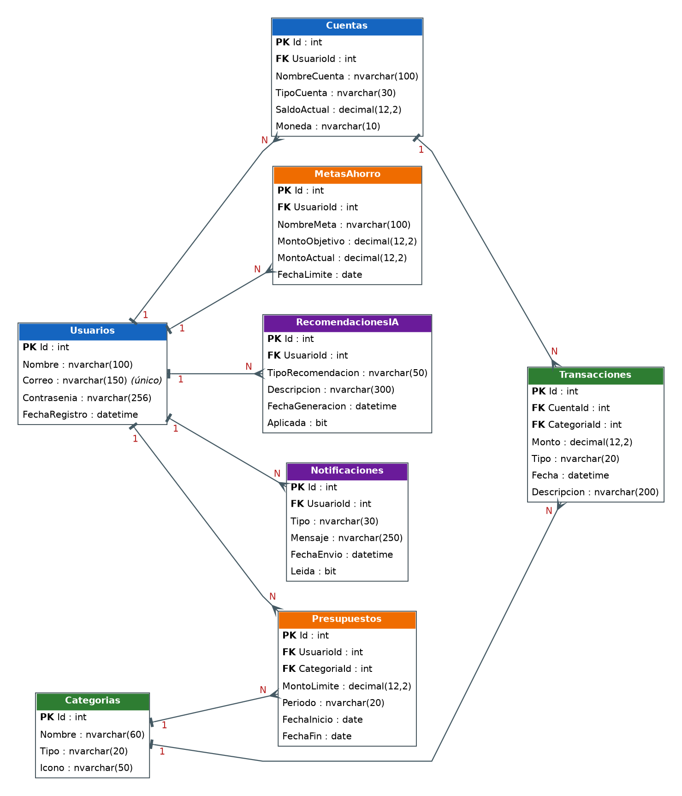

# Manual Técnico — Estructura del proyecto y base de datos

Proyecto: Gestor de Finanzas Personales · Materia DSP404 · Universidad Don Bosco

Este apartado del Manual Técnico describe cómo está organizado el código, cómo se guarda la información en SQL Server y cómo funciona el módulo de registro de movimientos (ingresos y gastos).

## 1. Estructura del proyecto

### 1.1 Carpetas del repositorio

El repositorio sigue la estructura que pide la actividad:

```
GestorFinanzas/
├── GestorFinanzas.sln
├── README.md
├── src/                        Código fuente
│   └── GestorFinanzas.Web/     Aplicación ASP.NET Core MVC (.NET 8)
├── docs/                       Manuales, diagramas y evidencias de pruebas
├── database/                   Scripts SQL (esquema, datos de demostración, consultas)
└── docker/                     Archivos de contenerización
```

### 1.2 Estructura de la aplicación

La aplicación es un solo proyecto, organizado en carpetas que representan las capas de la arquitectura: presentación, lógica de negocio y acceso a datos.

```
src/GestorFinanzas.Web/
├── Program.cs                  Arranque, servicios y configuración
├── appsettings.json            Cadena de conexión y opciones de base de datos
├── Controllers/                Capa de presentación: reciben las peticiones del navegador
├── Views/                      Capa de presentación: pantallas Razor (.cshtml)
├── ViewModels/                 Datos que viajan entre controladores y vistas
├── Services/                   Lógica de negocio y reglas
├── Data/
│   ├── AppDbContext.cs         Contexto de Entity Framework Core
│   ├── Configurations/         Reglas de cada tabla (Fluent API)
│   ├── Repositories/           Acceso a datos: consultas y cambios
│   ├── Migrations/             Historial de cambios de la base de datos
│   └── Seed/                   Categorías iniciales y datos de demostración
├── Models/
│   ├── Entities/               Las 8 entidades que se convierten en tablas
│   └── Filtros/                Filtros y resultados paginados
├── Infrastructure/             Excepciones propias del sistema
└── wwwroot/                    Archivos estáticos (CSS y JavaScript)
```

### 1.3 Recorrido de una petición

Cuando el estudiante registra un gasto, la información pasa por las capas en este orden:

1. **Vista** (`Movimientos/Create.cshtml`): el formulario envía los datos al servidor.
2. **Controlador** (`MovimientosController`): valida el formulario y convierte los datos a un objeto del negocio.
3. **Servicio** (`TransaccionService`): aplica las reglas de negocio y ajusta el saldo de la cuenta.
4. **Repositorio** (`TransaccionRepository`, `CuentaRepository`): prepara las consultas y los cambios.
5. **Entity Framework Core** (`AppDbContext`): traduce todo a SQL y lo guarda en SQL Server en una sola operación.

Cada capa solo conoce a la que tiene debajo, y se conectan mediante interfaces (`ITransaccionService`, `ITransaccionRepository`, etc.) registradas en `Program.cs` con inyección de dependencias. Por eso se puede cambiar una pieza, como el usuario actual, sin tocar las demás.

### 1.4 Convenciones

- Los nombres de clases, tablas y columnas están en español, como en el diccionario de datos de la Fase I. En el código se escriben sin tildes (`Categoria`, `Descripcion`).
- Las tablas están en plural (`Usuarios`, `Transacciones`).
- Los valores de texto con opciones fijas (`Ingreso`/`Gasto`, tipos de cuenta) están centralizados en `Models/Constantes.cs`.

## 2. Base de datos

### 2.1 Motor y forma de acceso

Se usa **SQL Server** con **Entity Framework Core 8** en el enfoque *Code First*: las clases de `Models/Entities` definen las tablas y las migraciones crean la base de datos. La base se llama `GestorFinanzasDB`.

### 2.2 Diagrama entidad-relación

{ width=5.2in }

El modelo tiene ocho entidades. Un **Usuario** tiene varias **Cuentas**, **Presupuestos**, **Metas de ahorro**, **Recomendaciones de IA** y **Notificaciones**. Cada **Cuenta** registra varias **Transacciones**, y cada **Categoría** clasifica varias Transacciones y varios Presupuestos.

### 2.3 Entidades

| Tabla | Para qué sirve | Relaciones |
|---|---|---|
| Usuarios | Perfil del estudiante y datos de acceso. La contraseña se guarda con hash. | Es dueño de Cuentas, Presupuestos, MetasAhorro, RecomendacionesIA y Notificaciones |
| Cuentas | Efectivo, ahorro, tarjeta u otra cuenta, con su saldo actual. | Pertenece a un Usuario; tiene muchas Transacciones |
| Categorias | Tipos de gasto e ingreso (Alimentación, Beca...). | Clasifica Transacciones y Presupuestos |
| Transacciones | Cada ingreso o gasto registrado. | Pertenece a una Cuenta y a una Categoría |
| Presupuestos | Límite de gasto por categoría en un período. | Pertenece a un Usuario y a una Categoría |
| MetasAhorro | Metas con monto objetivo y monto acumulado. | Pertenece a un Usuario |
| RecomendacionesIA | Consejos generados por el módulo de inteligencia artificial. | Pertenece a un Usuario |
| Notificaciones | Alertas para el estudiante. | Pertenece a un Usuario |

El detalle de cada campo (tipo de dato, descripción y restricciones) está en el Diccionario de Datos de la Fase I. Las diferencias de nombre son solo de escritura: en el código y en SQL no se usan tildes (`CategoriaId`, `Descripcion`, `Leida`).

### 2.4 Reglas de integridad

Además de las llaves primarias y foráneas, la base de datos protege los datos con restricciones propias, de modo que un dato incorrecto se rechaza aunque llegue por otro camino (por ejemplo, una consulta directa en SSMS).

**Restricciones CHECK**

| Tabla | Restricción |
|---|---|
| Transacciones | `Monto > 0` y `Tipo` solo puede ser `Ingreso` o `Gasto` |
| Categorias | `Tipo` solo puede ser `Ingreso` o `Gasto` |
| Cuentas | `TipoCuenta` solo puede ser `Ahorro`, `Corriente`, `Efectivo` o `Tarjeta` |
| Presupuestos | `MontoLimite > 0` y `FechaFin >= FechaInicio` |
| MetasAhorro | `MontoObjetivo > 0` y `MontoActual >= 0` |

**Índices únicos**

| Tabla | Columnas | Motivo |
|---|---|---|
| Usuarios | Correo | El correo identifica al usuario al iniciar sesión |
| Cuentas | UsuarioId, NombreCuenta | Un usuario no repite el nombre de una cuenta |
| Categorias | Nombre, Tipo | No se duplican categorías |
| Presupuestos | UsuarioId, CategoriaId, FechaInicio | No hay dos presupuestos de la misma categoría que empiecen el mismo día |

**Índices de consulta:** `Transacciones (CuentaId, Fecha)` acelera el historial y `Notificaciones (UsuarioId, Leida)` acelera el conteo de alertas sin leer.

**Comportamiento al eliminar**

- Al eliminar un **Usuario** se eliminan en cascada sus cuentas, presupuestos, metas, recomendaciones y notificaciones.
- Al eliminar una **Cuenta** se eliminan sus transacciones.
- Una **Categoría** que tiene transacciones o presupuestos **no se puede eliminar** (restricción).

### 2.5 Datos iniciales

La migración inserta 14 categorías: 10 de gasto (Alimentación, Transporte, Salud, Entretenimiento, Materiales de estudio, Educación, Servicios, Ropa y compras, Gastos hormiga y Otros gastos) y 4 de ingreso (Mesada o apoyo familiar, Beca, Trabajo de medio tiempo y Otros ingresos). La lista está en `Data/Seed/CategoriasIniciales.cs`.

### 2.6 Datos de demostración

Para poder probar el sistema desde el primer arranque, la aplicación puede cargar un usuario de demostración (`demo@estudiante.udb.edu.sv`) con tres cuentas, 19 movimientos de las últimas semanas, tres presupuestos, dos metas de ahorro, dos recomendaciones y dos notificaciones. Las fechas se calculan a partir del día actual, así que el historial siempre se ve reciente. Se controla con `BaseDeDatos:CargarDatosDemo` y no hace nada si el usuario ya existe. Debe desactivarse en un entorno real.

### 2.7 Migraciones

Las migraciones guardan el historial de cambios de la estructura. La migración inicial es `InitialCreate`, en `Data/Migrations`.

Comandos (desde la carpeta `src/GestorFinanzas.Web`, o en la Consola del Administrador de paquetes de Visual Studio con los equivalentes `Add-Migration` y `Update-Database`):

```
dotnet tool install --global dotnet-ef        (una sola vez)
dotnet ef migrations add NombreDelCambio      crea una migración nueva tras cambiar el modelo
dotnet ef database update                     aplica las migraciones pendientes
dotnet ef database update InitialCreate       regresa la base a una migración anterior
dotnet ef migrations remove                   deshace la última migración (si aún no se aplicó)
```

Con `BaseDeDatos:AplicarMigracionesAlIniciar` en `true`, la aplicación aplica las migraciones pendientes al arrancar, lo que facilita el uso con Docker. Si SQL Server aún no está listo, reintenta hasta 10 veces, cada 3 segundos.

### 2.8 Scripts SQL

La carpeta `database/` incluye `01_crear_esquema.sql`, `02_datos_demo.sql` y `03_consultas_utiles.sql`. Sirven para crear la base desde SSMS sin ejecutar la aplicación. El primero registra la migración `InitialCreate` en `__EFMigrationsHistory`, así que la aplicación no vuelve a crear las tablas. Se debe usar una opción o la otra sobre la misma base, no ambas.

### 2.9 Cadena de conexión

Está en `appsettings.json` bajo `ConnectionStrings:Default`. Por defecto usa SQL Server local con autenticación de Windows:

```
Server=localhost;Database=GestorFinanzasDB;Trusted_Connection=True;TrustServerCertificate=True;MultipleActiveResultSets=true
```

| Situación | Valor de `Server` / autenticación |
|---|---|
| SQL Server Express | `Server=localhost\SQLEXPRESS;...` |
| LocalDB (viene con Visual Studio) | `Server=(localdb)\MSSQLLocalDB;...` |
| Usuario y contraseña de SQL | `Server=localhost;Database=GestorFinanzasDB;User Id=sa;Password=<contraseña>;TrustServerCertificate=True` |
| Docker | Se sobrescribe con la variable de entorno `ConnectionStrings__Default` (doble guion bajo) |

Las contraseñas reales no se escriben en el repositorio: se pasan por variable de entorno.

## 3. Módulo Registrar movimiento

### 3.1 Qué incluye

- **Historial:** tabla paginada (10 por página) con totales de ingresos, gastos y balance, y filtros por texto, tipo, cuenta, categoría y rango de fechas.
- **Registrar, editar y eliminar** ingresos y gastos (CRUD completo).

### 3.2 Reglas de negocio

Están en `Services/TransaccionService.cs`:

1. El monto debe ser mayor que 0, con máximo 2 decimales.
2. La fecha no puede ser futura.
3. La cuenta debe pertenecer al usuario que hace la operación. Un usuario no puede ver ni modificar movimientos de otro.
4. La categoría debe ser del mismo tipo que el movimiento: un gasto no usa una categoría de ingreso.
5. Cada movimiento actualiza el saldo de su cuenta: un ingreso suma y un gasto resta. Al editar, se deshace el efecto original y se aplica el nuevo (incluso si cambia de cuenta). Al eliminar, el saldo se restaura.
6. Las cuentas que no son de tarjeta no pueden quedar con saldo negativo. Las de tarjeta sí, porque pueden representar crédito.

### 3.3 Validaciones en tres niveles

| Nivel | Dónde | Qué hace |
|---|---|---|
| Navegador | jQuery Validation | Avisa de campos obligatorios y valores inválidos antes de enviar |
| Servidor | Atributos del ViewModel y `TransaccionService` | Repite las validaciones y aplica las reglas de negocio; es la que realmente protege |
| Base de datos | Restricciones CHECK, índices y llaves | Rechaza datos inválidos aunque lleguen por otro camino |

### 3.4 Manejo de errores y concurrencia

- Las reglas de negocio lanzan `ReglaNegocioException`; el controlador captura el mensaje y lo muestra junto al formulario.
- `Cuentas.SaldoActual` es un token de concurrencia. Si dos operaciones modifican el saldo al mismo tiempo, la segunda falla con el mensaje «El saldo de la cuenta cambió mientras guardabas el movimiento» en lugar de sobrescribir a la primera.
- Los cambios de un movimiento y de las cuentas involucradas se guardan en una sola operación atómica: o se guarda todo o no se guarda nada.
- Los formularios usan token antifalsificación (`[ValidateAntiForgeryToken]`) y las consultas son parametrizadas por Entity Framework Core.

### 3.5 Puntos de integración con otros módulos

- **Usuario actual:** `ICurrentUserService` entrega el Id del usuario. Mientras no esté el login, `UsuarioDemoService` devuelve siempre el usuario de demostración. Al integrar la autenticación se cambia una sola línea en `Program.cs`.
- **Clasificación con IA:** el formulario recibe la categoría que elige el usuario. El módulo de IA puede sugerirla llamando a su servicio antes de `CrearAsync`, sin cambiar las reglas.
- **Alertas de presupuesto:** `TransaccionService.CrearAsync` es el lugar donde se puede avisar al módulo de notificaciones después de guardar un gasto.

## 4. Limitaciones conocidas

- El inicio de sesión no forma parte de este módulo: hasta integrarlo, la aplicación opera siempre con el usuario de demostración.
- El diseño visual es provisional (Bootstrap) y se reemplaza por la identidad visual de Figma.
- No hay un CRUD de cuentas: se crean desde los datos de demostración o con SQL. Si el equipo lo necesita, se agrega sobre `ICuentaRepository`.
